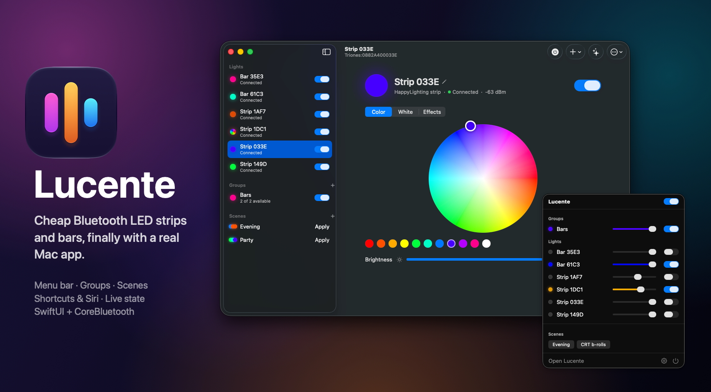
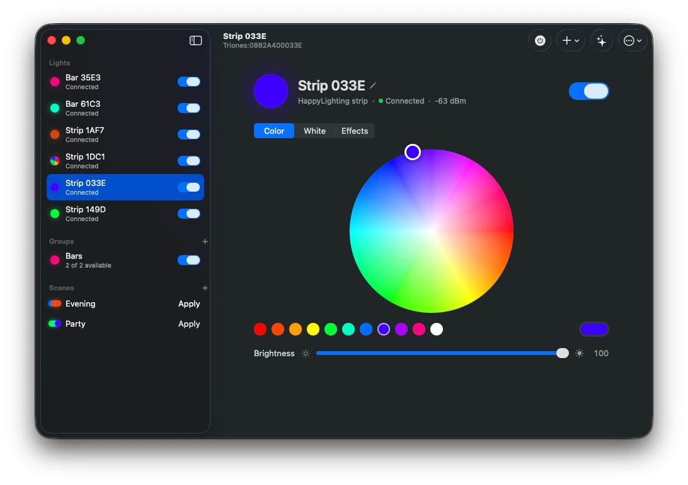
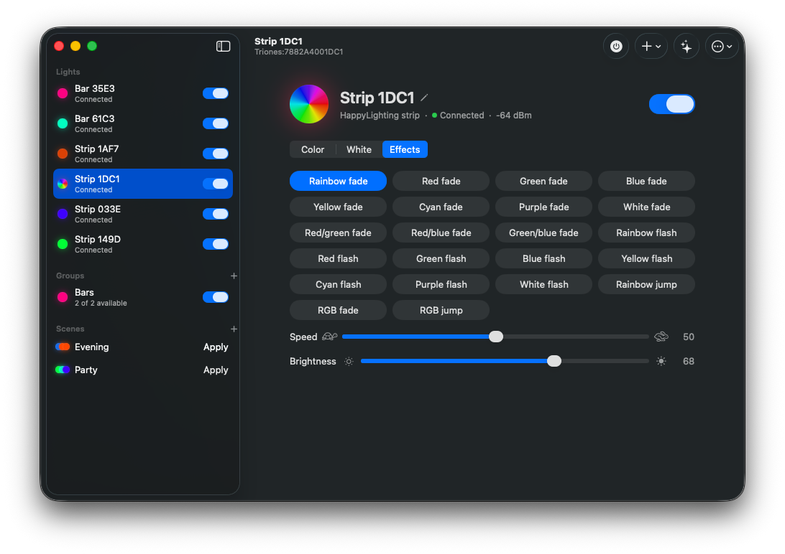
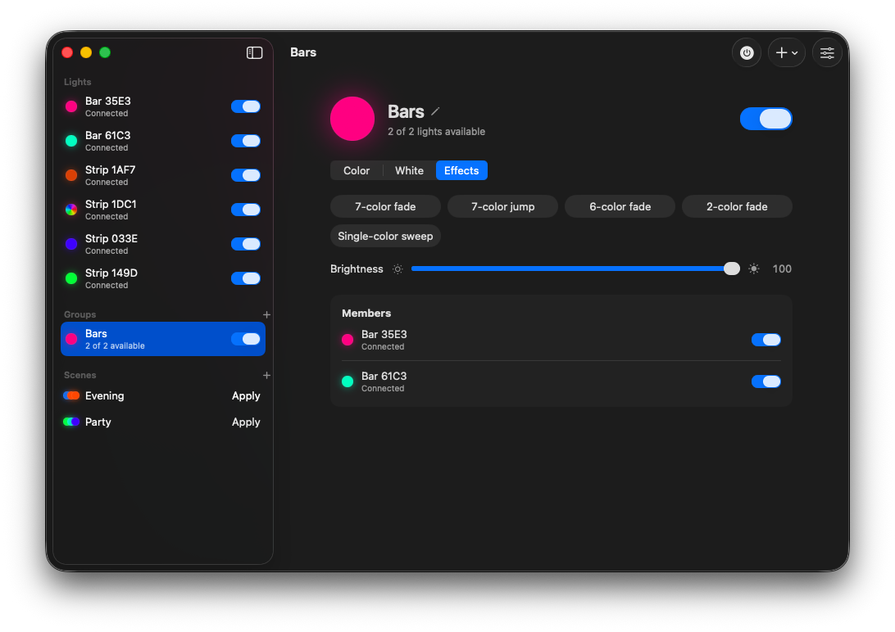
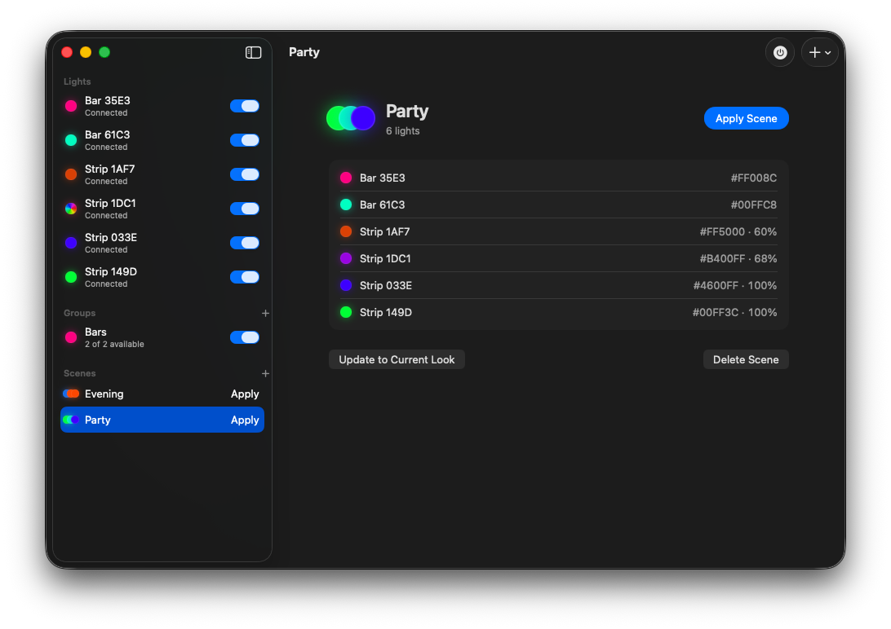
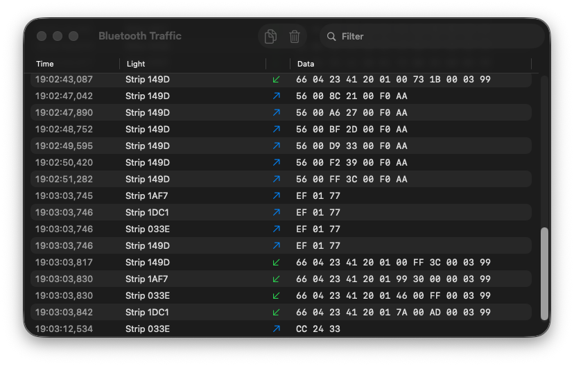
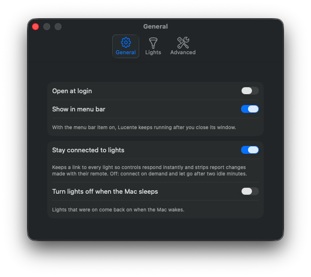
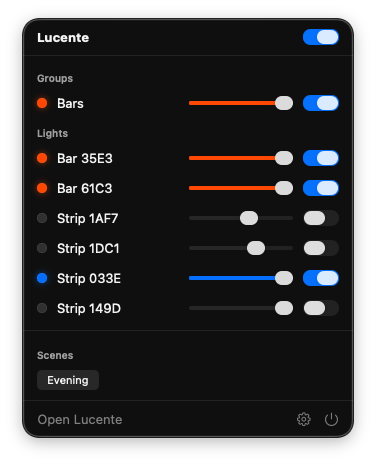

<p align="center"></p>

<p align="center">
  <a href="https://github.com/Francesco149/lucente-macos/releases/latest"></a>
  <a href="https://github.com/Francesco149/lucente-macos/actions/workflows/ci.yml"></a>
  
  
  
  
</p>

**Lucente** is a native Mac app for the cheap Bluetooth LED **strips** and **bars** sold all over
AliExpress — the ones that otherwise need two different phone apps (*HappyLighting* for Triones
strips, *Raingel* for DoHome bars). One window, a menu bar panel, groups, scenes, Shortcuts and
Siri, all talking straight to the lights over Bluetooth LE. No accounts, no cloud, no bridge.

Swift 6 · SwiftUI · CoreBluetooth · App Intents · zero third-party dependencies.

## Highlights

- **Zero setup.** Switch the lights on and they appear in the sidebar within seconds, with
  short default names you can change.
- **Instant, self-healing control.** Lucente holds a standing connection to every light, so a
  slider moves the light in real time and a dropped link reconnects on its own the moment the
  light is back.
- **Live state.** Strips report what they're showing, so changes made with their IR remote or the
  phone app show up in Lucente. Bars can't report back, so their last-sent state is remembered.
- **Everything the hardware does:** power, a hue/saturation wheel with presets and the system
  color picker, warm white, 22 built-in effects with speed, brightness. Each light only shows
  the controls it actually has.
- **Groups** drive several lights through the controls they share — keep only *Power* for an
  all-lights switch.
- **Scenes** snapshot every light and bring the look back in one click, from the menu bar, with
  ⌘1–⌘9, or from Shortcuts.
- **Lives in the menu bar.** Close the window and Lucente keeps running there with no Dock icon;
  it can open at login.
- **Shortcuts, Siri and Spotlight** actions that connect and send before reporting back, even
  if they had to launch the app first.
- **Follows your Mac** (optional): lights that were on switch off when the Mac sleeps and come back
  when it wakes.
- **Identify** blinks a light twice so you can tell two identical bars apart, then rename it.
- **Built for diagnosing cheap hardware:** a Bluetooth Traffic window with every byte sent and
  received, and a command-line probe for raw GATT work.

## A tour

| | |
|---|---|
|  |  |
| **Color.** Drag the wheel; the light follows live. Presets, or any color from the system picker. | **Effects.** Every effect the controller has built in, with speed. The running one is highlighted; the swatch turns into a spectrum. |
|  |  |
| **Groups.** Only the controls every member supports, applied to all of them at once. | **Scenes.** What each light was doing, restored with one click. Lights that should be off stay off. |
|  |  |
| **Traffic** (⌥⌘L). Every command and status reply, filterable and copyable. | **Settings.** Login item, menu bar, connection policy, sleep behaviour, forgotten lights. |



### The menu bar panel

One line per group and light: its color, a brightness slider tinted to match, and a power
switch, all lined up in columns. Scenes are one-click buttons, and a master switch covers
everything. The status icon fills in while any light is on.

With the panel enabled, closing the main window leaves Lucente running in the menu bar without a
Dock icon.

<br clear="right">

## Supported lights

| Family | Phone app | Recognised by | Controls | Reports state |
|---|---|---|---|---|
| **Triones / HappyLighting** strips (names starting `Triones`, `Color+`, `Dream`, `QHM`, `Flash`, `LD-`, …) | HappyLighting | advertised name | power, color, white, 22 effects + speed, brightness | ✅ status query every 20 s |
| **DoHome / Raingel** bars (e.g. `VC-BLELIGHT`) | Raingel | manufacturer ID `0x5958` or service `AF30` | power, color, white/CCT, effects, brightness (per the bar's capability byte) | ❌ write-only, last state remembered |

Both protocols were reverse-engineered from the vendor apps and confirmed on real hardware; the
specs are in [docs/protocols](docs/protocols). Adding another family is one Swift file (see
[Adding a light family](#adding-a-light-family)).

## Keyboard

| | |
|---|---|
| ⌘T | Toggle power of the selected light or group |
| ⌘= / ⌘- | Brighter / dimmer by 10% |
| ⌘I | Identify (blink) the selected light |
| ⌥⌘↑ / ⌥⌘↓ | All lights on / off |
| ⌘1 … ⌘9 | Apply scene |
| ⇧⌘N · ⌘S | New group · save scene |
| ⌘R | Reconnect all |
| ⌥⌘L | Bluetooth Traffic |
| ⌘, | Settings |

Double-click a light's name to rename it. Delete removes the selected group or scene.

## Shortcuts, Siri and Spotlight

| Action | Parameters |
|---|---|
| Turn Lights On or Off | a light, a group or *All Lights*; on / off / toggle |
| Set Light Color | target; a named color, or any hex code (`#FF8000`) |
| Set Light Brightness | target; 1–100 % |
| Apply Lighting Scene | any saved scene |
| Turn All Lights On / Off | — |

Ready-made phrases include *"Apply Evening in Lucente"*, *"Turn off the lights in Lucente"* and
*"Toggle Bars in Lucente"*. Actions run inside the app, launching it in the background when
needed, and report back once the commands have been sent to the lights (these controllers don't
acknowledge writes).

## Install

1. Download **Lucente-x.y.z.dmg** from the [latest release](https://github.com/Francesco149/lucente-macos/releases/latest).
2. Open it and drag **Lucente** into **Applications**. It runs on macOS 26, on Apple silicon and Intel.
3. The first launch asks for Bluetooth access. Turn the lights on nearby and they appear on their own.

Releases are signed with Developer ID and notarized by Apple, so Lucente opens like any other
app.

**From source** (Xcode 26 or newer, nothing else):

```bash
git clone https://github.com/Francesco149/lucente-macos.git
cd lucente-macos
make install        # Release build into /Applications
```

## Develop

```bash
make run            # build Debug and (re)launch
make test           # protocol/driver test suite, ~2 s, no hardware needed
make logs           # stream the app's unified log, Bluetooth traffic included
make dmg            # universal Release DMG into .build/dist
make open           # open in Xcode (⌘R runs, ⌘U tests)
make                # list everything
```

**Signing.** The committed config signs ad hoc so any clone builds. Ad hoc signatures change with
every build, so macOS re-asks for Bluetooth after each rebuild. For a stable signature, create
`Config/Local.xcconfig` (git-ignored):

```
CODE_SIGN_IDENTITY = Apple Development
DEVELOPMENT_TEAM = <your team ID>
```

**Project layout.** The Xcode project is a thin shell: `App/` is a synchronized folder (drop
files in, no project edits), and every build setting lives in readable `Config/*.xcconfig` files.
All logic is in a local Swift package, so its tests run from the command line in seconds.

```
App/                      SwiftUI app — window, sidebar, control panel, menu bar, settings, traffic
  Intents/                Shortcuts / Siri / Spotlight actions
  AppIcon.icon            Liquid Glass icon (Icon Composer)
Packages/LucenteKit/
  Sources/LucenteKit/
    Model/                vendor-neutral types: Capability, LightState, LightCommand, Effect
    Drivers/              LightDriver protocol, HappyLighting, Raingel, registry
    Bluetooth/            CoreBluetooth central + per-light link with paced, coalescing writes
    Store/                LightStore: discovery, connections, groups, scenes, persistence
  Sources/LucenteProbe/   the `scripts/probe` command-line tool
  Tests/                  Swift Testing suites for every encoder and parser
Config/                   xcconfig build settings + entitlements (sandboxed, Bluetooth only)
docs/                     protocol specs, the dual-mode bars investigation, images
scripts/                  probe wrapper, DMG packager, release + signing setup, hero image generator
.github/workflows/        CI (tests + DMG artifact) and tag-triggered releases
```

**Releasing.** Versions follow [semantic versioning](https://semver.org); the version lives in
`MARKETING_VERSION` in `Config/Lucente.xcconfig` and the build number is the commit count.

```bash
make release BUMP=patch     # or minor, major, or an explicit 1.4.0 / 2.0.0-beta.1
```

That runs the tests, bumps the version, commits, tags `vX.Y.Z` and pushes. The tag triggers the
[release workflow](.github/workflows/release.yml), which builds the universal DMG and publishes
it with release notes; a `-suffix` version becomes a pre-release. Every push and pull request
also gets a DMG as a [CI](.github/workflows/ci.yml) artifact. To make releases signed and
notarized (no Gatekeeper prompt), add a Developer ID certificate and an App Store Connect API key
as repository secrets — [docs/signing.md](docs/signing.md) walks through it, and
`scripts/setup-signing` does the exporting, checking and storing.

## Diagnosing a light

- **Traffic window** (⌥⌘L): the exact bytes of every command and every status reply.
- **`make logs`**: the same traffic in the unified log, alongside connection events.
- **`scripts/probe`**: a raw Bluetooth workbench that runs without the app. It is wrapped in a tiny
  app bundle so macOS grants it Bluetooth access whichever terminal, editor or agent launches it.

```bash
scripts/probe scan --all                          # every BLE device nearby, lights labelled
scripts/probe inspect D87A                        # full GATT table + live notifications
scripts/probe write D87A AE01 0101 03FF000000     # raw writes, 1.2 s apart
scripts/probe classic                             # BR/EDR inquiry — finds dual-mode radios
```

(Device ids are CoreBluetooth identifiers as printed by `scan`; any unique prefix works.)

## How it works

```
 SwiftUI views ─binds to─▶ LightStore (@Observable, @MainActor)
                              │ discovery · connections · groups · scenes · JSON persistence
                              ▼
                   LightDriver (pure value: command ⇄ bytes, status → state)
                              │ Frames tagged with a slot (power / color / level / effect)
                              ▼
                   PeripheralLink ─ paced 30 ms, latest-wins queue ─▶ CoreBluetooth ─▶ light
```

- **Drivers are pure.** A driver turns a `LightCommand` plus the current `LightState` into byte
  frames and the resulting state, and folds status packets back into state. No I/O, so every
  encoder and parser is unit-tested against bytes captured from the real devices.
- **Latest wins.** These controllers take *Write Without Response*, which has no flow control.
  Writes go out one at a time 30 ms apart, and frames for the same slot replace each other while
  queued, moving to the back. Dragging the color wheel sends the newest color rather than a
  backlog, and the last thing you did always lands last.
- **Write type from the real GATT.** CoreBluetooth silently drops a response-less write to a
  characteristic that doesn't advertise it, so each link picks its write type from the actual
  characteristic properties instead of trusting the vendor app.
- **Standing connections.** A CoreBluetooth connect never times out; it completes whenever the
  light next advertises. With *Stay connected* on, every known light has one pending, so control
  is instant and drops heal themselves with no polling. Commands sent while a light is away are
  buffered and delivered on reconnect, minus anything stale.
- **Main actor all the way down.** The central runs on the main queue and delegates use isolated
  conformances. The traffic is a handful of tiny writes, so this is simpler and safer than a
  Bluetooth actor.

### The bars and Linux

The bars turned out to be **dual-mode** radios (classic + LE) that also answer BR/EDR inquiries.
CoreBluetooth always connects them over LE, so they just work here. On Linux, BlueZ's
`Connect()` picks the classic bearer for such devices and the GATT connection never happens —
which is exactly why the bars, and only the bars, stopped working in the original Linux app. The
measurements, the BlueZ source trail and the fix are in
[docs/bars-investigation.md](docs/bars-investigation.md).

## Adding a light family

1. Add `Packages/LucenteKit/Sources/LucenteKit/Drivers/<Name>Driver.swift` conforming to
   `LightDriver`: how to recognise an advertisement, which GATT characteristics to use, and how
   commands and status packets map to bytes.
2. Add it to `DriverRegistry.drivers`.
3. Add encoder and parser tests to `DriverTests.swift` (`make test`).

Everything else — discovery, connections, the UI, groups, scenes, Shortcuts — works from the
capabilities the driver declares.

## Related

[**lucente**](https://github.com/Francesco149/lucente) — the original Python version for Windows
and Linux, with the APK reverse-engineering trail.

## License

MIT — see [LICENSE](LICENSE).
